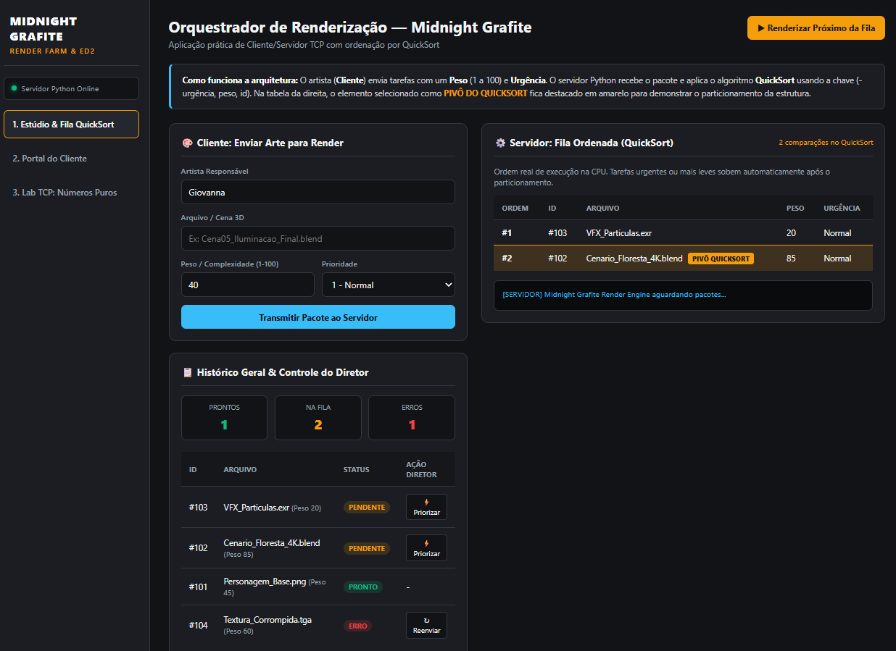
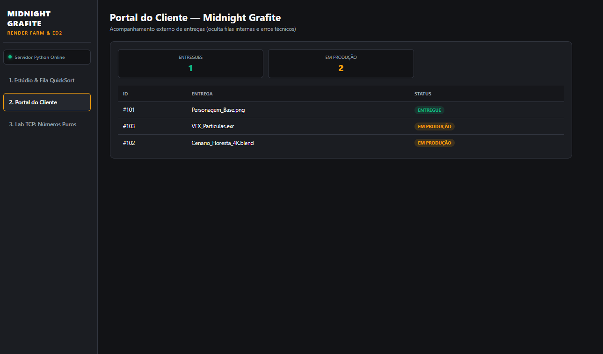
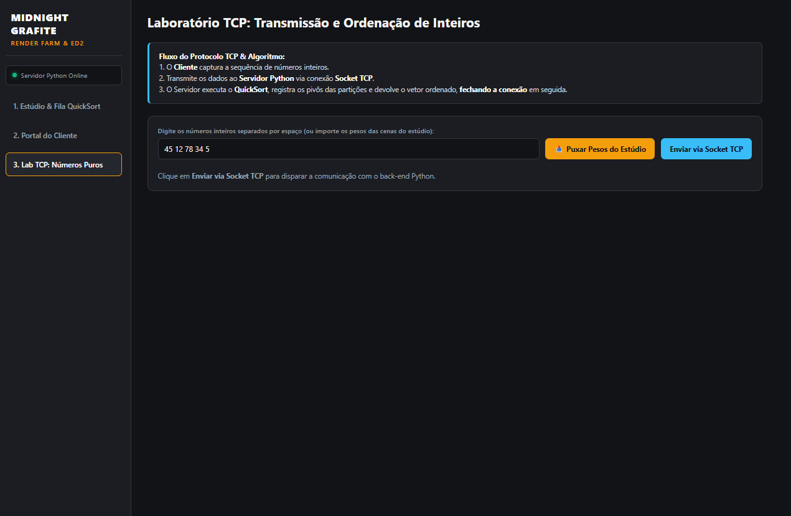

# 🎨 Midnight Grafite — Render Queue Manager

### Sistema de Enfileiramento e Priorização de Tarefas de Renderização

Projeto acadêmico desenvolvido para a disciplina de **Estrutura de Dados II**, com o objetivo de aplicar conceitos de algoritmos de ordenação, gerenciamento de filas e arquitetura cliente-servidor.

O sistema simula o funcionamento de uma render farm, permitindo cadastrar, organizar, priorizar e acompanhar tarefas de renderização por meio de uma interface web integrada a um servidor Python.

---

## 📌 Sobre o projeto

Em estúdios de animação e produção digital, diferentes artistas podem enviar tarefas de renderização com níveis variados de complexidade e urgência.

O **Midnight Grafite** foi desenvolvido para representar esse cenário, demonstrando como um servidor pode organizar solicitações de processamento utilizando o algoritmo **QuickSort**.

Cada tarefa possui um identificador, um artista responsável, um nome de arquivo, um peso de complexidade e um nível de urgência.

O servidor organiza a fila considerando três critérios:

1. **Urgência:** tarefas urgentes possuem prioridade.
2. **Complexidade:** entre tarefas de mesma urgência, as mais leves são executadas primeiro.
3. **Identificador:** utilizado como critério de desempate.

A ordenação é realizada no back-end Python, enquanto a interface web apresenta os resultados de forma visual e interativa.

---

## 🚀 Funcionalidades

### 1. Estúdio e Fila QuickSort

- Cadastro de tarefas de renderização.
- Definição do artista responsável e nome do arquivo.
- Configuração de peso/complexidade de 1 a 100.
- Seleção de prioridade normal ou alta.
- Organização automática da fila pelo QuickSort.
- Exibição da ordem de processamento.
- Contador de comparações do algoritmo.
- Visualização de um elemento destacado para fins didáticos.
- Histórico de tarefas com seus respectivos status.
- Priorização manual de tarefas pendentes.
- Reenvio de tarefas que apresentaram erro.
- Simulação do processamento da próxima tarefa.

### 2. Portal do Cliente

Interface simplificada para acompanhar as entregas sem expor informações internas do servidor.

- Visualização de tarefas entregues.
- Acompanhamento das tarefas em produção.
- Consulta de identificadores e nomes dos arquivos.
- Exibição dos status de entrega.

### 3. Laboratório de Ordenação

Ambiente didático para demonstrar o algoritmo QuickSort.

- Entrada de sequências de números inteiros.
- Importação dos pesos das tarefas cadastradas.
- Envio dos números para a API Python.
- Ordenação dos valores pelo QuickSort.
- Exibição dos pivôs utilizados nas partições.
- Comparação visual entre os vetores original e ordenado.

**Observação:** a comunicação do laboratório é realizada por requisições HTTP à API FastAPI, que utiliza TCP como transporte. O código atual não implementa diretamente uma conexão por sockets TCP.

---

## 🛠️ Tecnologias utilizadas

| Tecnologia | Aplicação |
|------------|-----------|
| Python | Lógica do servidor e algoritmos |
| FastAPI | Desenvolvimento da API REST |
| Uvicorn | Execução do servidor web |
| Pydantic | Modelagem e validação de dados |
| HTML5 | Estrutura da interface |
| CSS3 | Estilização e layout |
| JavaScript | Interatividade e consumo da API |
| Git e GitHub | Versionamento do projeto |

---

## 🧠 Algoritmo QuickSort

O QuickSort foi utilizado como principal algoritmo de ordenação do sistema.

Sua implementação seleciona um pivô e divide os elementos em três grupos:

- Elementos menores que o pivô.
- Elementos iguais ao pivô.
- Elementos maiores que o pivô.

O processo é aplicado recursivamente até que os elementos estejam ordenados.

Na fila de renderização, a ordenação utiliza a chave:

`(-urgencia, peso, id)`

Dessa forma, as tarefas mais urgentes são posicionadas primeiro. Em caso de mesma urgência, o sistema considera a complexidade e, por último, o identificador.

A implementação também registra a quantidade de comparações realizadas durante a ordenação da fila.

---

## 🏗️ Arquitetura do sistema

O projeto utiliza uma arquitetura cliente-servidor composta por duas partes principais.

### Front-end

Desenvolvido com HTML, CSS e JavaScript, é responsável pela interface visual, interação com o usuário e comunicação com a API.

### Back-end

Desenvolvido em Python com FastAPI, é responsável por:

- Receber e validar solicitações.
- Gerenciar as tarefas cadastradas.
- Executar o algoritmo QuickSort.
- Definir a ordem de processamento.
- Atualizar os status das tarefas.
- Retornar os dados para a interface.

Os dados são armazenados em memória durante a execução do servidor, com utilização de `threading.Lock` para controlar o acesso concorrente às operações compartilhadas.

---

## 📂 Estrutura do projeto

```text
render-queue-manager/
│
├── index.html       # Interface web
├── server.py        # API e algoritmos em Python
├── README.md        # Documentação
└── .gitignore       # Arquivos ignorados pelo Git
```

---

## ⚙️ Como executar o projeto

### Pré-requisitos

- Python 3.10 ou superior
- Navegador web atualizado
- Visual Studio Code (opcional)

### 1. Clonar o repositório

```bash
git clone https://github.com/SEU-USUARIO/render-queue-manager.git
```

Acesse a pasta:

```bash
cd render-queue-manager
```

### 2. Instalar as dependências

No terminal, execute:

```bash
python -m pip install fastapi uvicorn pydantic
```

### 3. Iniciar o servidor Python

```bash
python -m uvicorn server:app --reload --port 8000
```

O servidor estará disponível em:

`http://127.0.0.1:8000`

A documentação interativa da API pode ser acessada em:

`http://127.0.0.1:8000/docs`

### 4. Abrir a interface web

Abra o arquivo `index.html` no navegador, mantendo o servidor Python em execução.

O painel deverá indicar **Servidor Python Online** quando a comunicação com a API estiver funcionando.

---

## 🔄 Simulação de processamento

Ao selecionar a opção **Renderizar Próximo da Fila**, o sistema identifica a tarefa de maior prioridade e simula seu processamento.

A tarefa pode receber os status:

- `pendente` — aguardando processamento.
- `pronto` — processamento simulado concluído.
- `erro` — falha simulada no processamento.

A simulação utiliza resultados aleatórios para representar sucesso ou falha. Não ocorre renderização real de arquivos de imagem ou cenas 3D.

---

## 📸 Demonstração da interface

### Estúdio e Fila QuickSort


### Portal do Cliente


### Laboratório de Ordenação


---

## 📚 Conceitos aplicados

O desenvolvimento do projeto permitiu explorar conceitos de:

- Estruturas de dados e gerenciamento de filas.
- Algoritmos de ordenação e recursividade.
- Particionamento e seleção de pivôs.
- Programação cliente-servidor.
- Desenvolvimento de APIs REST.
- Requisições HTTP.
- Modelagem e validação de dados.
- Controle básico de concorrência.
- Integração entre front-end e back-end.

---

## 🔮 Possíveis melhorias futuras

- Implementar comunicação diretamente por sockets TCP.
- Adicionar persistência de dados com banco de dados.
- Criar autenticação e perfis de acesso.
- Implementar processamento assíncrono de tarefas.
- Adicionar integração com ferramentas reais de renderização.
- Aprimorar a visualização das etapas do QuickSort.
- Implementar testes automatizados.

---

## 👩‍💻 Autoria

Projeto acadêmico desenvolvido por **Giovanna Nunes Alexandre, Giovanna Teodoro Lofrani e Gabriel de Freitas Amaral**, estudantes de Engenharia da Computação no Centro Universitário Adventista de São Paulo (UNASP).
Desenvolvido como aplicação prática dos conhecimentos de Estrutura de Dados II, algoritmos e desenvolvimento de sistemas.